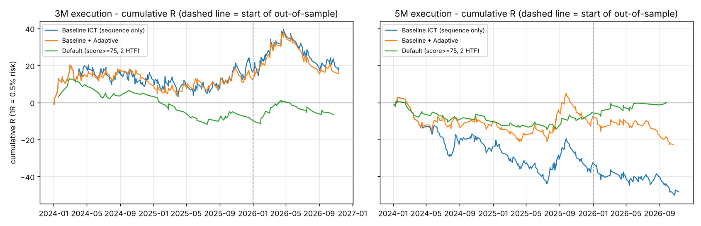

# Backtesting report

Every number in this file was produced by `research/run_report.py` on real tick-derived data. Nothing is estimated,
extrapolated or taken from TradingView (TradingView cannot be driven from the environment this was built in — see
[LIMITATIONS.md](LIMITATIONS.md)). Re-run the script to reproduce it; the full machine-generated tables are in the
appendix below and in `research/results/`.

## Verdict

**The research target was not met, and the system has no demonstrated edge.**

| Question | Answer |
|---|---|
| Profit factor ≥ 2.0? | **No.** Best statistically meaningful result: PF 1.09 (3M baseline, development), PF 1.03 out-of-sample. |
| High win rate? | **No.** 29–36 % at the default 1:3 reward. At 1:1 the win rate is 47 % and expectancy is negative. |
| Positive expectancy after costs? | **Not demonstrated.** 3M: +0.06 R per trade in development (t = 0.6) and +0.02 R out-of-sample (t = 0.1) — indistinguishable from zero. 5M: negative in both periods. |
| Does the 0–100 score predict outcomes? | **No.** Spearman correlation between score and trade result is −0.10 (3M) and −0.14 (5M). Raising the minimum score to 75 does not improve results; it only shrinks the sample. |
| Does the adaptive engine help? | **No evidence.** It changes results within noise in both directions (table 1, section 6). |
| Does walk-forward re-selection help? | **No.** Selected configurations were unstable from window to window and the stitched result is not significant. |
| Is the default configuration (score ≥ 75, 2 HTF) validated? | **Inconclusive.** It produces ~30 trades a year — far too few to judge. |

Do not trade this with real money on the strength of these results. What the project does deliver is a correct,
non-repainting, risk-controlled implementation and a test harness that reports honestly; treat it as a research
platform and forward-test it (see [FORWARD_TESTING.md](FORWARD_TESTING.md)).

## What was tested

| Item | Value |
|---|---|
| Data | Dukascopy XAUUSD tick data (bid and ask), 207 million ticks, aggregated to 1-minute bid/ask bars |
| Period available | 2024-01-01 → 2026-11-15 |
| Development (in-sample) | 2024-01-01 → 2025-12-31 |
| Out-of-sample | 2026-01-01 → 2026-11-15, never used to choose anything |
| **2023** | **Not tested.** No 2023 intraday gold data was obtainable from this environment (Dukascopy's server refused the connection; the only public mirrors found start in 2024). The requested 2023–2025 development window is therefore 2024–2025. |
| Signals | computed on bid bars (what a chart shows), 3-minute and 5-minute |
| Fills | longs buy the recorded ask and exit on the bid; shorts sell the bid and exit on the ask — i.e. the real, time-varying spread is paid on every trade |
| Intrabar resolution | 1-minute bars (same idea as Bar Magnifier); stop assumed first if stop and target share a 1-minute bar |
| Commission | zero (Tauro Markets account configuration) |
| Slippage | zero in the main tables; sensitivity in section 3 |
| Risk | 0.5 % per trade, max 5 trades/day, 1.5 % daily loss stop, 3 consecutive losses per day, flat by 16:50 New York |
| Sizing | fractional (no lot rounding) — results are in R and in compounded account % |

"t_stat" is the mean trade result divided by its standard error. |t| < 2 means the result cannot be told apart from
zero edge. A sample under 100 trades is labelled inconclusive regardless of how good or bad it looks.

Important caveat on the data source: Dukascopy is not OANDA and is not Tauro Markets. Prices are near-identical,
but spreads differ. Recorded mean spread was $0.38 (2024), $0.62 (2025) and $0.71 (2026) per ounce. Section 3 shows
how sensitive the result is: with zero spread the 3M baseline earns +0.16 R per trade; at 1.5× the recorded spread
it loses. **Cost is the difference between a marginal gain and a loss, so your broker's real spread decides this.**

## Reading the results

1. **The raw ICT sequence is roughly a coin flip before costs.** In the widest sample, 38 % of trades reach +1 R
   before the stop and about 21 % reach +2 R; that is what a random entry with this stop/target geometry would
   give. Gross of spread there is a small positive drift (+0.16 R, t = 1.6) which is not significant either.
2. **Filters do not concentrate the edge.** No single component — liquidity type, displacement strength, FVG size,
   HTF alignment, order block, kill zone — separates winners from losers consistently between development and
   out-of-sample (section 2). In the exploratory diagnostics order-block confluence was, if anything, worse.
3. **3M beats 5M in this sample**, but the 3M result is not significant, so this is not evidence that 3M "works".
4. **Structural stops are wide.** The stop sits beyond the sweep extreme and the entry is taken on a confirmation
   close, so most setups need a stop of 3 ATR or more on the chart timeframe; 795 3M setups over the whole sample
   were rejected for exceeding the 3.5 ATR cap. With a 1:3 target many trades run for hours and about 16 % end at
   the end-of-day flatten.
5. **Trade management did not rescue it.** Breakeven at 1 R and partial profits raise the win rate (46 % with a
   partial) and lower expectancy (section 4). This is the "high win rate, negative expectancy" trap the brief
   warns against.
6. **Drawdown is controlled.** The risk rules work as designed: worst peak-to-trough was −8.6 % (3M baseline,
   development) and −10.6 % out-of-sample at 0.5 % risk, with losing runs of up to 11 trades.

## What was deliberately not done

After the first diagnostics showed no edge, the parameter space was **not** searched for a combination that
back-fits a PF of 2. With ~280 development trades and |t| < 2 everywhere, any configuration found that way would
be noise. One round of pre-declared structural variants was run on the development period only (stop anchored at
the FVG origin instead of the sweep extreme, deeper retrace, stricter liquidity grade, order block required, 1H/4H
veto, different structure lengths, opposing-liquidity targets). None was significant; the FVG-origin stop was
significantly *worse* (t = −2.5) and is left as a non-default option.

## Honest next steps if you want to continue the research

- Get more data (2019–2023) so that hypotheses can be tested with thousands of trades rather than hundreds.
- Measure your real Tauro Markets spread during London and New York and re-run section 3 with it.
- Test a different entry mechanic (resting limit order inside the gap instead of a confirmation close), which
  changes the stop distance and therefore the whole reward geometry. This is a different strategy and needs its
  own out-of-sample test.
- Treat any future improvement as real only if it survives data it was not tuned on.

---

# Appendix: generated tables

## 1. Strategy comparison

### Development 2024-01-01 .. 2025-12-31 - 3M execution

| config | trades | win_rate | pf | exp_r | t_stat | net_r | net_pct | max_dd_pct | avg_win_r | avg_loss_r | max_consec_loss | avg_mfe_r | avg_mae_r | verdict |
|---|---|---|---|---|---|---|---|---|---|---|---|---|---|---|
| Baseline ICT (sequence only) | 284 | 33.8 | 1.09 | 0.058 | 0.6 | 16.4 | 7.6 | -8.6 | 2.17 | -1.02 | 11 | 1.23 | 0.85 | not significant |
| Baseline + Adaptive | 187 | 33.2 | 1.09 | 0.066 | 0.54 | 12.3 | 5.7 | -8.2 | 2.3 | -1.04 | 9 | 1.27 | 0.88 | not significant |
| Moderate (score>=65, 1 HTF) | 166 | 34.3 | 1.06 | 0.038 | 0.3 | 6.3 | 2.7 | -8.9 | 2.1 | -1.04 | 8 | 1.22 | 0.87 | not significant |
| Moderate + Adaptive | 82 | 30.5 | 0.95 | -0.036 | -0.2 | -2.9 | -1.7 | -11.8 | 2.28 | -1.05 | 14 | 1.14 | 0.89 | inconclusive (n<100) |
| Default (score>=75, 2 HTF) | 66 | 28.8 | 0.81 | -0.141 | -0.74 | -9.3 | -4.7 | -11.7 | 2.1 | -1.05 | 8 | 1.09 | 0.89 | inconclusive (n<100) |
| Default + Adaptive | 39 | 28.2 | 0.87 | -0.097 | -0.37 | -3.8 | -2.0 | -8.8 | 2.39 | -1.07 | 12 | 1.09 | 0.91 | inconclusive (n<100) |
| Strict (75, 2 HTF, 1H/4H veto, graded liquidity, OB) | 34 | 35.3 | 0.93 | -0.051 | -0.19 | -1.7 | -1.0 | -5.5 | 1.8 | -1.06 | 5 | 1.06 | 0.86 | inconclusive (n<100) |

### Development 2024-01-01 .. 2025-12-31 - 5M execution

| config | trades | win_rate | pf | exp_r | t_stat | net_r | net_pct | max_dd_pct | avg_win_r | avg_loss_r | max_consec_loss | avg_mfe_r | avg_mae_r | verdict |
|---|---|---|---|---|---|---|---|---|---|---|---|---|---|---|
| Baseline ICT (sequence only) | 206 | 30.1 | 0.78 | -0.158 | -1.57 | -32.6 | -15.5 | -21.1 | 1.85 | -1.02 | 17 | 1.03 | 0.86 | not significant |
| Baseline + Adaptive | 162 | 33.3 | 0.93 | -0.047 | -0.39 | -7.6 | -4.2 | -11.5 | 1.9 | -1.02 | 10 | 1.09 | 0.84 | not significant |
| Moderate (score>=65, 1 HTF) | 130 | 30.8 | 0.8 | -0.145 | -1.13 | -18.8 | -9.3 | -15.6 | 1.83 | -1.02 | 10 | 1.03 | 0.86 | not significant |
| Moderate + Adaptive | 40 | 20.0 | 0.47 | -0.429 | -2.12 | -17.2 | -8.3 | -9.6 | 1.88 | -1.01 | 10 | 0.86 | 0.93 | inconclusive (n<100) |
| Default (score>=75, 2 HTF) | 64 | 31.2 | 0.88 | -0.086 | -0.45 | -5.5 | -2.9 | -7.6 | 1.96 | -1.01 | 8 | 1.03 | 0.88 | inconclusive (n<100) |
| Default + Adaptive | 25 | 16.0 | 0.45 | -0.447 | -1.74 | -11.2 | -5.5 | -5.9 | 2.32 | -0.97 | 8 | 0.81 | 0.94 | inconclusive (n<100) |
| Strict (75, 2 HTF, 1H/4H veto, graded liquidity, OB) | 30 | 23.3 | 0.7 | -0.244 | -0.86 | -7.3 | -3.7 | -5.9 | 2.46 | -1.07 | 9 | 1.1 | 0.96 | inconclusive (n<100) |

### Out-of-sample 2026-01-01 .. 2026-11-15 - 3M execution

| config | trades | win_rate | pf | exp_r | t_stat | net_r | net_pct | max_dd_pct | avg_win_r | avg_loss_r | max_consec_loss | avg_mfe_r | avg_mae_r | verdict |
|---|---|---|---|---|---|---|---|---|---|---|---|---|---|---|
| Baseline ICT (sequence only) | 121 | 28.9 | 1.03 | 0.02 | 0.13 | 2.5 | 0.8 | -10.6 | 2.54 | -1.0 | 11 | 1.25 | 0.87 | not significant |
| Baseline + Adaptive | 85 | 30.6 | 1.08 | 0.055 | 0.3 | 4.7 | 2.1 | -10.9 | 2.44 | -1.0 | 11 | 1.24 | 0.85 | inconclusive (n<100) |
| Moderate (score>=65, 1 HTF) | 75 | 34.7 | 1.26 | 0.169 | 0.85 | 12.7 | 6.2 | -7.2 | 2.35 | -0.99 | 10 | 1.28 | 0.83 | inconclusive (n<100) |
| Moderate + Adaptive | 24 | 33.3 | 1.07 | 0.049 | 0.14 | 1.2 | 0.5 | -4.5 | 2.18 | -1.02 | 7 | 1.21 | 0.83 | inconclusive (n<100) |
| Default (score>=75, 2 HTF) | 28 | 35.7 | 1.15 | 0.095 | 0.3 | 2.6 | 1.2 | -3.9 | 2.05 | -0.99 | 6 | 1.12 | 0.82 | inconclusive (n<100) |
| Default + Adaptive | 12 | 16.7 | 0.58 | -0.351 | -0.79 | -4.2 | -2.1 | -3.0 | 2.97 | -1.01 | 5 | 0.84 | 0.89 | inconclusive (n<100) |
| Strict (75, 2 HTF, 1H/4H veto, graded liquidity, OB) | 6 | 50.0 | 2.74 | 0.881 | 1.03 | 5.3 | 2.6 | -0.5 | 2.78 | -1.01 | 1 | 1.53 | 0.77 | inconclusive (n<100) |

### Out-of-sample 2026-01-01 .. 2026-11-15 - 5M execution

| config | trades | win_rate | pf | exp_r | t_stat | net_r | net_pct | max_dd_pct | avg_win_r | avg_loss_r | max_consec_loss | avg_mfe_r | avg_mae_r | verdict |
|---|---|---|---|---|---|---|---|---|---|---|---|---|---|---|
| Baseline ICT (sequence only) | 76 | 26.3 | 0.71 | -0.206 | -1.26 | -15.7 | -7.7 | -8.6 | 1.95 | -0.98 | 8 | 1.08 | 0.86 | inconclusive (n<100) |
| Baseline + Adaptive | 53 | 26.4 | 0.61 | -0.284 | -1.55 | -15.0 | -7.4 | -7.4 | 1.65 | -0.98 | 10 | 1.08 | 0.85 | inconclusive (n<100) |
| Moderate (score>=65, 1 HTF) | 43 | 27.9 | 0.75 | -0.175 | -0.81 | -7.5 | -3.8 | -4.0 | 1.84 | -0.96 | 7 | 1.14 | 0.84 | inconclusive (n<100) |
| Moderate + Adaptive | 5 | 20.0 | 0.2 | -0.64 | -1.79 | -3.2 | -1.6 | -2.0 | 0.79 | -1.0 | 4 | 0.86 | 0.94 | inconclusive (n<100) |
| Default (score>=75, 2 HTF) | 21 | 42.9 | 1.49 | 0.264 | 0.75 | 5.5 | 2.7 | -2.1 | 1.86 | -0.93 | 5 | 1.26 | 0.73 | inconclusive (n<100) |
| Default + Adaptive | 1 | 100.0 | inf | 0.789 |  | 0.8 | 0.4 | 0.0 | 0.79 | 0.0 | 0 | 1.83 | 0.73 | inconclusive (n<100) |
| Strict (75, 2 HTF, 1H/4H veto, graded liquidity, OB) | 7 | 57.1 | 2.56 | 0.673 | 0.99 | 4.7 | 2.4 | -0.5 | 1.93 | -1.01 | 1 | 1.64 | 0.64 | inconclusive (n<100) |

## 2. Breakdowns (Baseline ICT, no score gate - largest sample)

### 3M by session

| period | session | n | win_rate | exp_r | net_r |
|---|---|---|---|---|---|
| DEV | London | 133 | 27.8 | 0.048 | 6.4 |
| DEV | New York | 151 | 39.1 | 0.066 | 10.0 |
| OOS | London | 67 | 22.4 | -0.126 | -8.4 |
| OOS | New York | 54 | 37.0 | 0.202 | 10.9 |

### 3M by weekday

| period | weekday | n | win_rate | exp_r | net_r |
|---|---|---|---|---|---|
| DEV | Friday | 55 | 23.6 | -0.414 | -22.8 |
| DEV | Monday | 60 | 33.3 | 0.062 | 3.7 |
| DEV | Thursday | 46 | 30.4 | 0.048 | 2.2 |
| DEV | Tuesday | 70 | 40.0 | 0.377 | 26.4 |
| DEV | Wednesday | 53 | 39.6 | 0.131 | 7.0 |
| OOS | Friday | 22 | 27.3 | -0.024 | -0.5 |
| OOS | Monday | 22 | 22.7 | -0.082 | -1.8 |
| OOS | Thursday | 24 | 37.5 | 0.453 | 10.9 |
| OOS | Tuesday | 28 | 25.0 | -0.233 | -6.5 |
| OOS | Wednesday | 25 | 32.0 | 0.018 | 0.5 |

### 3M by score_bucket

| period | score_bucket | n | win_rate | exp_r | net_r |
|---|---|---|---|---|---|
| DEV | (0, 60] | 30 | 43.3 | 0.412 | 12.4 |
| DEV | (60, 65] | 50 | 36.0 | 0.206 | 10.3 |
| DEV | (65, 70] | 58 | 25.9 | -0.181 | -10.5 |
| DEV | (70, 75] | 63 | 38.1 | 0.157 | 9.9 |
| DEV | (75, 80] | 49 | 28.6 | -0.145 | -7.1 |
| DEV | (80, 100] | 34 | 35.3 | 0.043 | 1.5 |
| OOS | (0, 60] | 12 | 25.0 | -0.098 | -1.2 |
| OOS | (60, 65] | 21 | 19.0 | -0.247 | -5.2 |
| OOS | (65, 70] | 26 | 42.3 | 0.565 | 14.7 |
| OOS | (70, 75] | 25 | 24.0 | -0.201 | -5.0 |
| OOS | (75, 80] | 23 | 17.4 | -0.382 | -8.8 |
| OOS | (80, 100] | 14 | 50.0 | 0.567 | 7.9 |

### 3M by liquidity

| period | liquidity | n | win_rate | exp_r | net_r |
|---|---|---|---|---|---|
| DEV | equal H/L | 6 | 33.3 | -0.434 | -2.6 |
| DEV | external swing | 14 | 42.9 | 0.243 | 3.4 |
| DEV | internal swing | 104 | 35.6 | 0.146 | 15.2 |
| DEV | prev 1H | 116 | 31.9 | 0.002 | 0.3 |
| DEV | prev 4H | 21 | 42.9 | 0.28 | 5.9 |
| DEV | prev day | 5 | 40.0 | 0.189 | 0.9 |
| DEV | prev session | 18 | 16.7 | -0.366 | -6.6 |
| OOS | equal H/L | 3 | 100.0 | 2.958 | 8.9 |
| OOS | external swing | 9 | 33.3 | 0.22 | 2.0 |
| OOS | internal swing | 56 | 25.0 | -0.078 | -4.3 |
| OOS | prev 1H | 35 | 22.9 | -0.267 | -9.3 |
| OOS | prev 4H | 10 | 30.0 | 0.089 | 0.9 |
| OOS | prev day | 2 | 0.0 | -1.024 | -2.0 |
| OOS | prev session | 6 | 66.7 | 1.078 | 6.5 |

### 3M by exit

| period | exit | n | win_rate | exp_r | net_r |
|---|---|---|---|---|---|
| DEV | stop | 180 | 0.0 | -1.052 | -189.4 |
| DEV | target | 58 | 100.0 | 2.951 | 171.1 |
| DEV | time/EOD | 46 | 82.6 | 0.755 | 34.7 |
| OOS | stop | 84 | 0.0 | -1.022 | -85.8 |
| OOS | target | 25 | 100.0 | 2.986 | 74.6 |
| OOS | time/EOD | 12 | 83.3 | 1.137 | 13.6 |

### 3M by year

| period | year | n | win_rate | exp_r | net_r |
|---|---|---|---|---|---|
| DEV | 2024 | 140 | 34.3 | 0.092 | 12.9 |
| DEV | 2025 | 144 | 33.3 | 0.025 | 3.5 |
| OOS | 2026 | 121 | 28.9 | 0.02 | 2.5 |

3M score calibration (DEV): Spearman correlation between score and trade R = -0.101 (n=284).

3M signals rejected by filter (Default config, whole sample): `{'session': 2096, 'htf': 213, 'score': 125, 'stop_min': 0, 'stop_max': 795, 'room': 0, 'day_trades': 0, 'day_loss': 0, 'consec': 0, 'cooldown': 0, 'in_position': 0, 'volatility': 31, 'spread': 0, 'ob_required': 0, 'eod': 0, 'profit_lock': 0}`

### 5M by session

| period | session | n | win_rate | exp_r | net_r |
|---|---|---|---|---|---|
| DEV | London | 93 | 22.6 | -0.226 | -21.0 |
| DEV | New York | 113 | 36.3 | -0.103 | -11.6 |
| OOS | London | 34 | 26.5 | -0.141 | -4.8 |
| OOS | New York | 42 | 26.2 | -0.26 | -10.9 |

### 5M by weekday

| period | weekday | n | win_rate | exp_r | net_r |
|---|---|---|---|---|---|
| DEV | Friday | 44 | 29.5 | -0.259 | -11.4 |
| DEV | Monday | 37 | 40.5 | 0.274 | 10.1 |
| DEV | Thursday | 42 | 23.8 | -0.351 | -14.7 |
| DEV | Tuesday | 39 | 33.3 | -0.085 | -3.3 |
| DEV | Wednesday | 44 | 25.0 | -0.302 | -13.3 |
| OOS | Friday | 11 | 45.5 | 0.39 | 4.3 |
| OOS | Monday | 19 | 26.3 | -0.309 | -5.9 |
| OOS | Thursday | 16 | 31.2 | -0.024 | -0.4 |
| OOS | Tuesday | 18 | 16.7 | -0.468 | -8.4 |
| OOS | Wednesday | 12 | 16.7 | -0.44 | -5.3 |

### 5M by score_bucket

| period | score_bucket | n | win_rate | exp_r | net_r |
|---|---|---|---|---|---|
| DEV | (0, 60] | 25 | 12.0 | -0.55 | -13.7 |
| DEV | (60, 65] | 25 | 44.0 | 0.468 | 11.7 |
| DEV | (65, 70] | 32 | 40.6 | 0.16 | 5.1 |
| DEV | (70, 75] | 44 | 25.0 | -0.329 | -14.5 |
| DEV | (75, 80] | 41 | 26.8 | -0.429 | -17.6 |
| DEV | (80, 100] | 39 | 33.3 | -0.092 | -3.6 |
| OOS | (0, 60] | 13 | 30.8 | -0.029 | -0.4 |
| OOS | (60, 65] | 10 | 10.0 | -0.62 | -6.2 |
| OOS | (65, 70] | 11 | 18.2 | -0.319 | -3.5 |
| OOS | (70, 75] | 15 | 20.0 | -0.517 | -7.8 |
| OOS | (75, 80] | 13 | 38.5 | 0.024 | 0.3 |
| OOS | (80, 100] | 14 | 35.7 | 0.132 | 1.8 |

### 5M by liquidity

| period | liquidity | n | win_rate | exp_r | net_r |
|---|---|---|---|---|---|
| DEV | external swing | 2 | 0.0 | -1.054 | -2.1 |
| DEV | internal swing | 29 | 27.6 | -0.156 | -4.5 |
| DEV | prev 1H | 124 | 34.7 | -0.012 | -1.5 |
| DEV | prev 4H | 32 | 25.0 | -0.339 | -10.8 |
| DEV | prev day | 3 | 0.0 | -1.021 | -3.1 |
| DEV | prev session | 16 | 18.8 | -0.656 | -10.5 |
| OOS | external swing | 3 | 33.3 | 0.344 | 1.0 |
| OOS | internal swing | 21 | 28.6 | -0.182 | -3.8 |
| OOS | prev 1H | 38 | 21.1 | -0.376 | -14.3 |
| OOS | prev 4H | 6 | 33.3 | 0.321 | 1.9 |
| OOS | prev day | 1 | 100.0 | 0.778 | 0.8 |
| OOS | prev session | 7 | 28.6 | -0.186 | -1.3 |

### 5M by exit

| period | exit | n | win_rate | exp_r | net_r |
|---|---|---|---|---|---|
| DEV | stop | 138 | 0.0 | -1.048 | -144.6 |
| DEV | target | 27 | 100.0 | 2.934 | 79.2 |
| DEV | time/EOD | 41 | 85.4 | 0.799 | 32.8 |
| OOS | stop | 53 | 0.0 | -1.017 | -53.9 |
| OOS | target | 10 | 100.0 | 2.991 | 29.9 |
| OOS | time/EOD | 13 | 76.9 | 0.637 | 8.3 |

### 5M by year

| period | year | n | win_rate | exp_r | net_r |
|---|---|---|---|---|---|
| DEV | 2024 | 95 | 27.4 | -0.249 | -23.6 |
| DEV | 2025 | 111 | 32.4 | -0.081 | -9.0 |
| OOS | 2026 | 76 | 26.3 | -0.206 | -15.7 |

5M score calibration (DEV): Spearman correlation between score and trade R = -0.139 (n=206).

5M signals rejected by filter (Default config, whole sample): `{'session': 1279, 'htf': 137, 'score': 70, 'stop_min': 0, 'stop_max': 519, 'room': 0, 'day_trades': 0, 'day_loss': 0, 'consec': 0, 'cooldown': 0, 'in_position': 0, 'volatility': 37, 'spread': 0, 'ob_required': 0, 'eod': 0, 'profit_lock': 0}`

## 3. Cost sensitivity (Baseline ICT, 3M, development period)

| config | trades | win_rate | pf | exp_r | t_stat | net_r | net_pct | max_dd_pct | avg_win_r | avg_loss_r | max_consec_loss | avg_mfe_r | avg_mae_r | verdict |
|---|---|---|---|---|---|---|---|---|---|---|---|---|---|---|
| zero spread (gross) | 282 | 35.5 | 1.25 | 0.156 | 1.59 | 44.0 | 23.4 | -5.4 | 2.21 | -0.97 | 11 | 1.35 | 0.79 | not significant |
| 0.5x recorded spread | 284 | 34.2 | 1.13 | 0.088 | 0.91 | 25.0 | 12.2 | -7.0 | 2.19 | -1.0 | 11 | 1.27 | 0.82 | not significant |
| 1.0x recorded spread | 284 | 33.8 | 1.09 | 0.058 | 0.6 | 16.4 | 7.6 | -8.6 | 2.17 | -1.02 | 11 | 1.23 | 0.85 | not significant |
| 1.5x recorded spread | 284 | 32.4 | 0.96 | -0.026 | -0.28 | -7.4 | -4.5 | -13.0 | 2.11 | -1.05 | 11 | 1.16 | 0.89 | not significant |
| 1.0x spread + $0.10 slippage/side | 284 | 33.8 | 1.03 | 0.021 | 0.21 | 5.9 | 2.0 | -11.7 | 2.15 | -1.07 | 11 | 1.21 | 0.89 | not significant |

Recorded Dukascopy spread (USD/oz) by year:

| year | mean | median | p95 |
|---|---|---|---|
| 2024.0 | 0.383 | 0.379 | 0.482 |
| 2025.0 | 0.618 | 0.584 | 0.857 |
| 2026.0 | 0.706 | 0.664 | 1.012 |

## 4. Risk/reward and trade-management variants (Baseline ICT, 3M)

| config | trades | win_rate | pf | exp_r | t_stat | net_r | net_pct | max_dd_pct | avg_win_r | avg_loss_r | max_consec_loss | OOS trades | OOS exp_r | OOS pf |
|---|---|---|---|---|---|---|---|---|---|---|---|---|---|---|
| RR 1:1 | 294 | 46.6 | 0.79 | -0.115 | -2.01 | -33.8 | -15.9 | -20.5 | 0.92 | -1.02 | 7 | 124 | -0.017 | 0.97 |
| RR 1:1.5 | 289 | 41.2 | 0.92 | -0.051 | -0.73 | -14.7 | -7.6 | -12.9 | 1.34 | -1.02 | 7 | 123 | -0.046 | 0.92 |
| RR 1:2 | 287 | 39.0 | 1.06 | 0.04 | 0.5 | 11.6 | 5.2 | -8.2 | 1.69 | -1.02 | 9 | 123 | -0.113 | 0.84 |
| RR 1:3 (default) | 284 | 33.8 | 1.09 | 0.058 | 0.6 | 16.4 | 7.6 | -8.6 | 2.17 | -1.02 | 11 | 121 | 0.02 | 1.03 |
| RR 1:4 | 281 | 30.2 | 1.04 | 0.027 | 0.26 | 7.7 | 2.8 | -13.4 | 2.46 | -1.03 | 11 | 119 | -0.024 | 0.97 |
| RR 1:3 + breakeven at 1R | 289 | 25.3 | 1.0 | -0.003 | -0.03 | -0.8 | -1.1 | -10.4 | 2.17 | -0.74 | 13 | 122 | 0.088 | 1.17 |
| RR 1:3 + 50% partial at 1R + breakeven | 289 | 46.0 | 0.91 | -0.051 | -0.75 | -14.7 | -7.5 | -14.2 | 1.09 | -1.02 | 7 | 122 | 0.022 | 1.04 |
| RR 1:3 + ATR trail from 1.5R | 289 | 40.8 | 1.03 | 0.018 | 0.22 | 5.1 | 1.9 | -7.7 | 1.53 | -1.02 | 7 | 123 | 0.004 | 1.01 |
| Opposing-liquidity target | 285 | 35.8 | 1.12 | 0.077 | 0.81 | 21.8 | 10.5 | -6.1 | 2.05 | -1.03 | 9 | 122 | 0.018 | 1.03 |

## 5. Walk-forward validation (3M and 5M)

### 3M - 6-month train / 3-month test, rolled every 3 months, 12 candidate configs, selection by train t-statistic (not net profit)

| train | test | chosen | train_t | test_trades | test_exp_r | test_net_r |
|---|---|---|---|---|---|---|
| 2024-01-01..2024-07-01 | 2024-07-01..2024-10-01 | {'min_score': 0, 'htf_req': 0, 'rr': 2.0} | 1.16 | 34 | -0.241 | -8.2 |
| 2024-04-01..2024-10-01 | 2024-10-01..2025-01-01 | {'min_score': 0, 'htf_req': 2, 'rr': 3.0} | 0.03 | 12 | 0.096 | 1.2 |
| 2024-07-01..2025-01-01 | 2025-01-01..2025-04-01 | none (no config with positive train expectancy) -> stand aside |  | 0 |  | 0.0 |
| 2024-10-01..2025-04-01 | 2025-04-01..2025-07-01 | {'min_score': 0, 'htf_req': 0, 'rr': 2.0} | 0.15 | 34 | 0.065 | 2.2 |
| 2025-01-01..2025-07-01 | 2025-07-01..2025-10-01 | none (no config with positive train expectancy) -> stand aside |  | 0 |  | 0.0 |
| 2025-04-01..2025-10-01 | 2025-10-01..2026-01-01 | {'min_score': 0, 'htf_req': 0, 'rr': 3.0} | 0.57 | 38 | 0.125 | 4.7 |
| 2025-07-01..2026-01-01 | 2026-01-01..2026-04-01 | {'min_score': 0, 'htf_req': 0, 'rr': 3.0} | 0.46 | 45 | 0.355 | 16.0 |
| 2025-10-01..2026-04-01 | 2026-04-01..2026-07-01 | {'min_score': 65, 'htf_req': 0, 'rr': 3.0} | 1.75 | 20 | 0.125 | 2.5 |
| 2026-01-01..2026-07-01 | 2026-07-01..2026-10-01 | {'min_score': 65, 'htf_req': 0, 'rr': 3.0} | 1.52 | 30 | -0.118 | -3.5 |
| 2026-04-01..2026-10-01 | 2026-10-01..2027-01-01 | none (no config with positive train expectancy) -> stand aside |  | 0 |  | 0.0 |

| config | trades | win_rate | pf | exp_r | t_stat | net_r | net_pct | max_dd_pct | avg_win_r | avg_loss_r | max_consec_loss | avg_mfe_r | avg_mae_r | verdict |
|---|---|---|---|---|---|---|---|---|---|---|---|---|---|---|
| Walk-forward selected (all test windows stitched) | 213 | 33.8 | 1.1 | 0.07 | 0.63 | 14.8 | 7.0 | -6.3 | 2.17 | -1.0 | 9 | 1.18 | 0.85 | not significant |
| Fixed Baseline over the same test span | 337 | 31.2 | 1.02 | 0.011 | 0.12 | 3.7 | 0.8 | -10.6 | 2.27 | -1.01 | 11 | 1.21 | 0.86 | not significant |

### 5M - 6-month train / 3-month test, rolled every 3 months, 12 candidate configs, selection by train t-statistic (not net profit)

| train | test | chosen | train_t | test_trades | test_exp_r | test_net_r |
|---|---|---|---|---|---|---|
| 2024-01-01..2024-07-01 | 2024-07-01..2024-10-01 | none (no config with positive train expectancy) -> stand aside |  | 0 |  | 0.0 |
| 2024-04-01..2024-10-01 | 2024-10-01..2025-01-01 | none (no config with positive train expectancy) -> stand aside |  | 0 |  | 0.0 |
| 2024-07-01..2025-01-01 | 2025-01-01..2025-04-01 | {'min_score': 0, 'htf_req': 2, 'rr': 3.0} | 0.12 | 12 | -0.694 | -8.3 |
| 2024-10-01..2025-04-01 | 2025-04-01..2025-07-01 | none (no config with positive train expectancy) -> stand aside |  | 0 |  | 0.0 |
| 2025-01-01..2025-07-01 | 2025-07-01..2025-10-01 | none (no config with positive train expectancy) -> stand aside |  | 0 |  | 0.0 |
| 2025-04-01..2025-10-01 | 2025-10-01..2026-01-01 | {'min_score': 0, 'htf_req': 2, 'rr': 3.0} | 1.88 | 14 | -0.158 | -2.2 |
| 2025-07-01..2026-01-01 | 2026-01-01..2026-04-01 | {'min_score': 0, 'htf_req': 2, 'rr': 3.0} | 1.5 | 11 | 0.122 | 1.3 |
| 2025-10-01..2026-04-01 | 2026-04-01..2026-07-01 | none (no config with positive train expectancy) -> stand aside |  | 0 |  | 0.0 |
| 2026-01-01..2026-07-01 | 2026-07-01..2026-10-01 | {'min_score': 75, 'htf_req': 0, 'rr': 3.0} | 0.46 | 3 | 0.137 | 0.4 |
| 2026-04-01..2026-10-01 | 2026-10-01..2027-01-01 | none (no config with positive train expectancy) -> stand aside |  | 0 |  | 0.0 |

| config | trades | win_rate | pf | exp_r | t_stat | net_r | net_pct | max_dd_pct | avg_win_r | avg_loss_r | max_consec_loss | avg_mfe_r | avg_mae_r | verdict |
|---|---|---|---|---|---|---|---|---|---|---|---|---|---|---|
| Walk-forward selected (all test windows stitched) | 40 | 27.5 | 0.68 | -0.22 | -1.04 | -8.8 | -4.4 | -6.9 | 1.7 | -0.95 | 7 | 0.95 | 0.87 | inconclusive (n<100) |
| Fixed Baseline over the same test span | 238 | 30.3 | 0.82 | -0.125 | -1.3 | -29.6 | -14.3 | -15.8 | 1.91 | -1.01 | 11 | 1.07 | 0.85 | not significant |

## 6. Adaptive engine activity

3M Baseline + Adaptive: 41 filter changes over 272 trades; trades by adaptive level at entry: L0 n=53 exp=0.261R; L1 n=19 exp=-0.003R; L2 n=57 exp=-0.395R; L3 n=86 exp=0.261R; L4 n=57 exp=0.057R

3M Moderate + Adaptive: 18 filter changes over 106 trades; trades by adaptive level at entry: L0 n=91 exp=-0.04R; L1 n=12 exp=0.417R; L2 n=3 exp=-1.049R

3M Default + Adaptive: 12 filter changes over 51 trades; trades by adaptive level at entry: L0 n=51 exp=-0.157R

5M Baseline + Adaptive: 39 filter changes over 215 trades; trades by adaptive level at entry: L0 n=31 exp=-0.68R; L1 n=33 exp=-0.243R; L2 n=58 exp=0.124R; L3 n=64 exp=-0.059R; L4 n=29 exp=0.105R

5M Moderate + Adaptive: 10 filter changes over 45 trades; trades by adaptive level at entry: L0 n=42 exp=-0.509R; L1 n=3 exp=0.337R

5M Default + Adaptive: 4 filter changes over 26 trades; trades by adaptive level at entry: L0 n=26 exp=-0.4R
